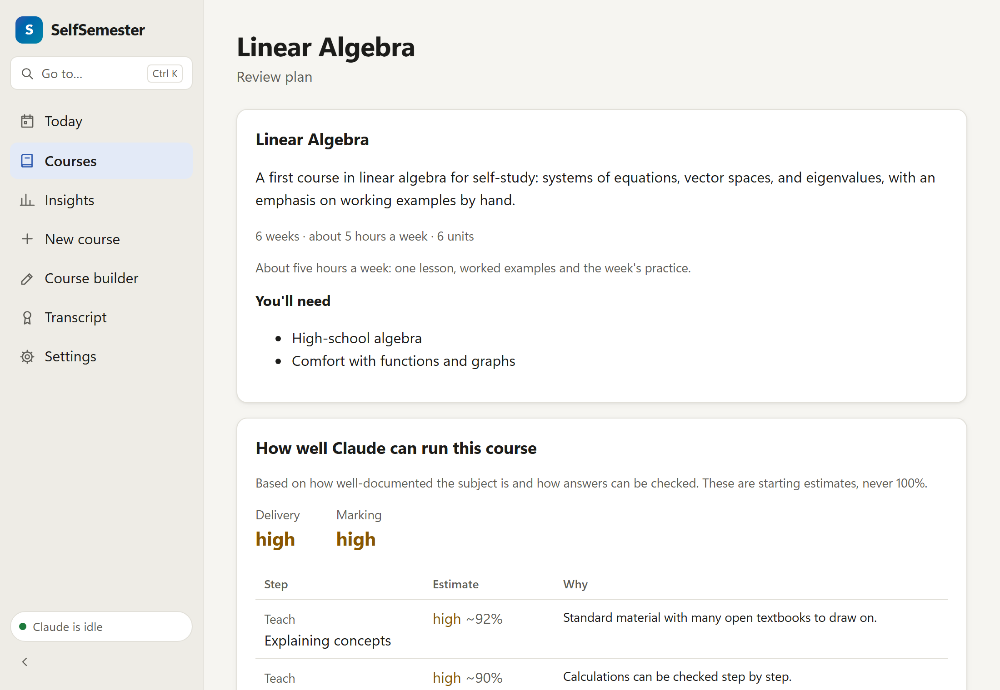
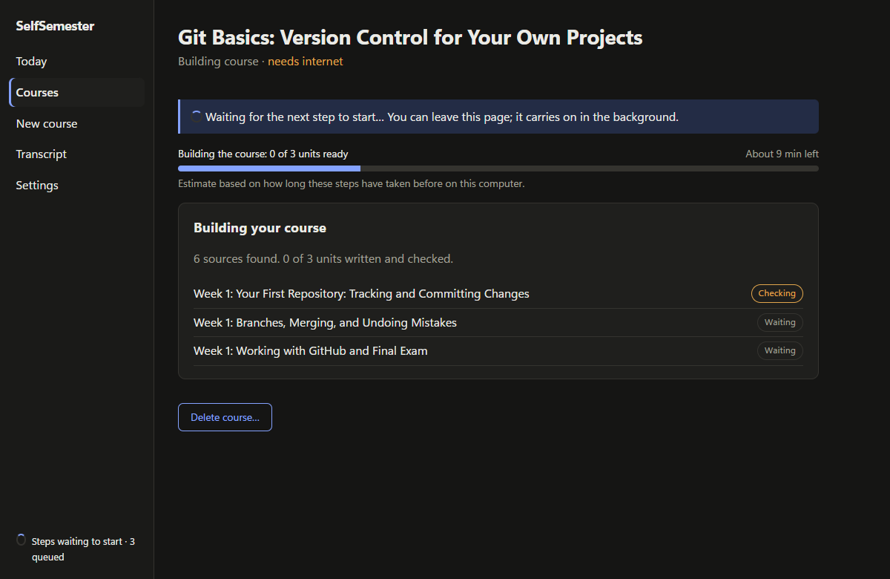
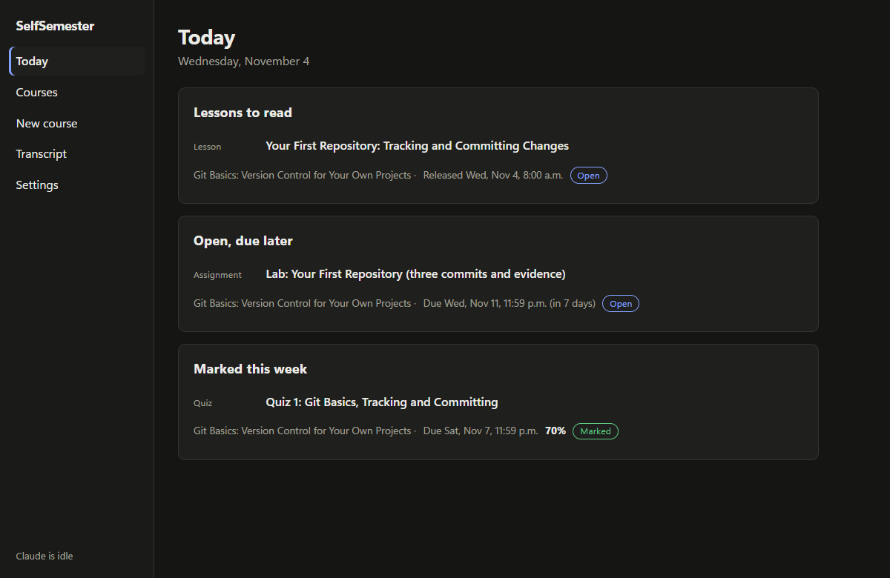
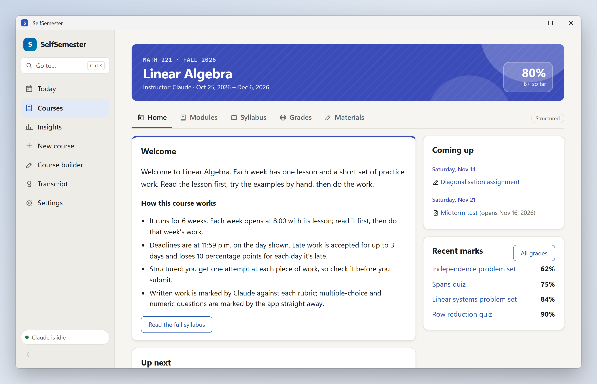
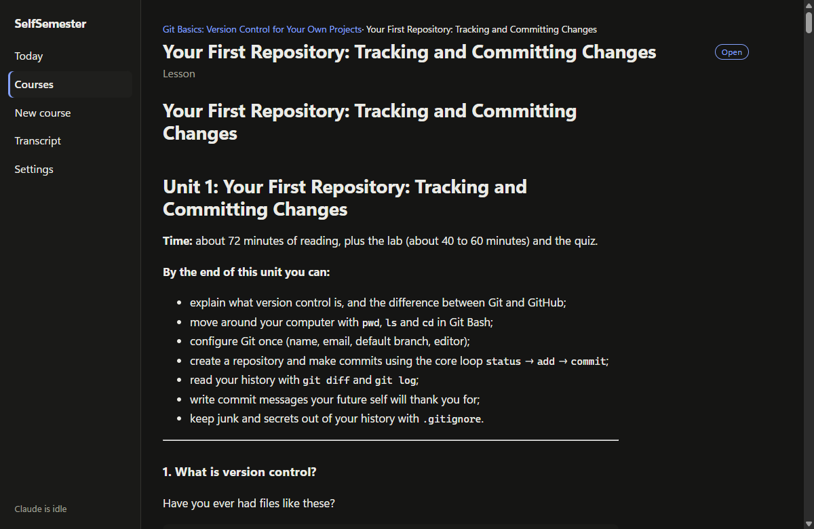
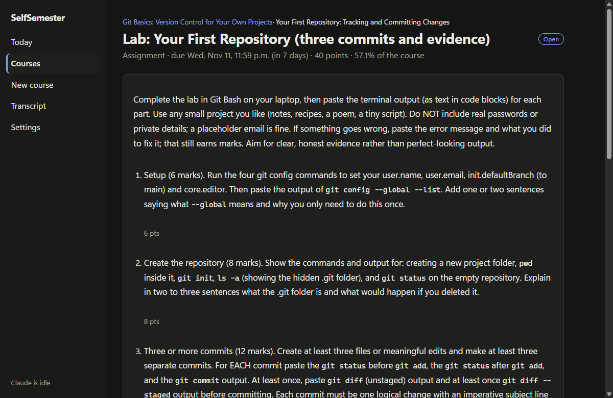
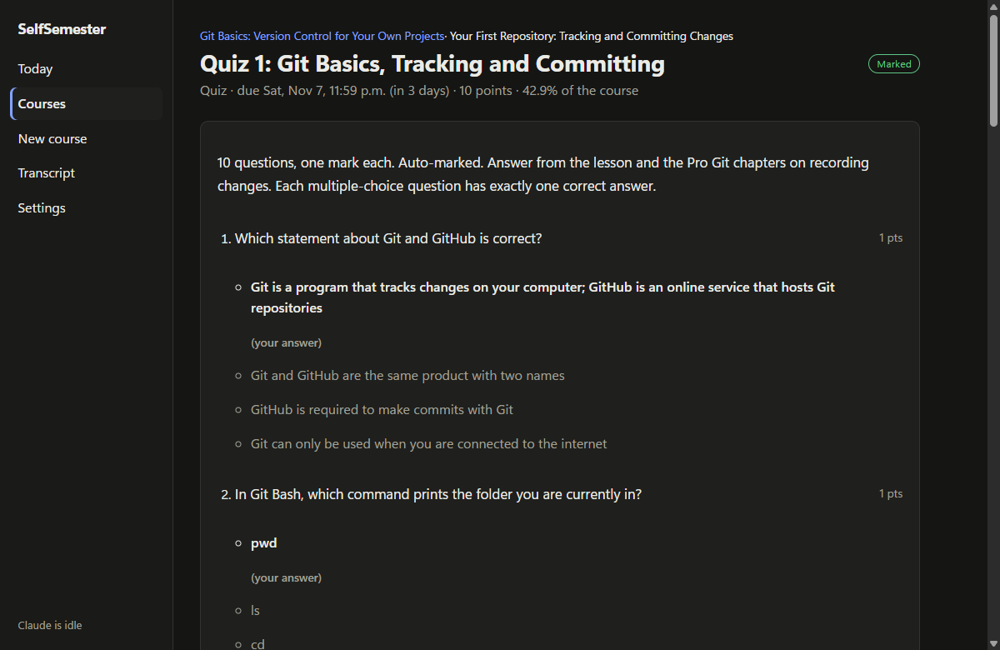
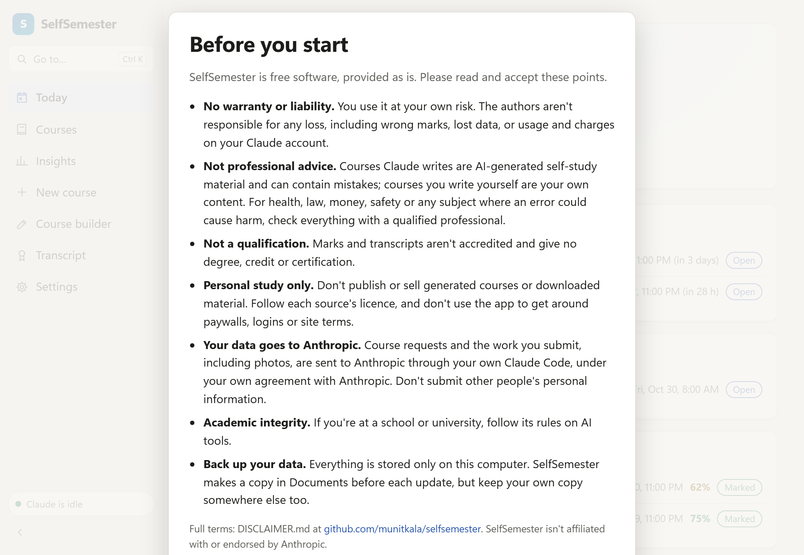

<p align="center"></p>

# SelfSemester

A Windows desktop app that turns any subject into a full university-style course: lessons, homework, quizzes,
assignments and exams, released on a schedule with hard deadlines and real marks.

You name a subject. Claude asks a few questions about your goals and level, plans a syllabus, and tells you how well
it can teach and mark that subject before you commit. Once you approve, it writes the whole course up front. After
that the app runs the course on its own: it releases material day by day, enforces deadlines, auto-marks quizzes,
and sends written work and photos of handwritten working back to Claude for marking against a rubric. Final marks
go on a transcript, and finished courses are archived to your Documents folder.

> **Status: early (0.1.0).** It works end to end but has had little real-world use. Expect rough edges.

## Screenshots

Shown with a one-week "Git basics" course that Claude generated for a test run (example names in it are made up).

| | |
| --- | --- |
|  |  |
| **Plan review:** syllabus, pacing and honest accuracy estimates before anything is built | **Building:** each unit is written, then checked by a second model |
|  |  |
| **Today:** what's due, what's new, what's been marked | **Course:** units, deadlines, states and the running mark |
|  |  |
| **Lesson:** full self-study lessons, with a distraction-free reading mode | **Assignment:** deadline, points and share of the final grade |
|  |  |
| **Quiz:** marked instantly, with the right answer explained for each miss | **First launch:** the terms every user accepts |

## Requirements

| What | Details |
| --- | --- |
| Windows 10 or 11, 64-bit | Uses Microsoft Edge WebView2, which Windows 11 already has (the installer adds it on Windows 10 if needed). |
| [Claude Code](https://claude.com/claude-code) | Installed and signed in **with a Claude subscription** (Pro or Max). SelfSemester runs your own copy of Claude Code; there's no API key to enter. |
| Internet | Needed while a course is being built and whenever work is marked. Reading lessons and doing work happen offline. |

To build from source you also need Node.js 20+, Rust 1.85+ and the Visual Studio C++ build tools (see below).

## Before you use it

- **Cost.** SelfSemester itself is free. Signed in with a Claude subscription, Claude Code adds no extra charges. If
  Claude Code is signed in with an API key instead, every call is billed to that key; the Settings page tells you
  which one you're using.
- **Usage limits.** Building a course is heavy work: roughly one call per stage plus two per unit, with each unit
  taking a few minutes. A long course can use a large share of your plan's limits. When a limit is reached, the
  app pauses and tries again at the reset time Claude Code reports (or at least every hour). If your limit has
  reset sooner, press **Resume now**. A progress bar shows roughly how long building or marking has left, based on
  how long each step has taken before on your computer.
- **Keep the app open while a course is building.** Building, releases, deadline checks and reminders only run while
  the window is open. Anything that fell due while it was closed is settled the next time you open it.
- **AI teaching and marking can be wrong.** Before you enrol, each course shows a readiness report with honest
  estimates for every step; none is ever 100%. A second model checks each unit, but mistakes can still get through.
  Every mark shows its reasoning and the answer key, so you can check it.
- **Not a qualification.** Transcripts record your own study. They aren't accredited and shouldn't be presented as
  if they were.
- **Sealed files keep honest people honest.** Answer keys and unreleased exams are encrypted on disk, but the key is
  on the same computer. It stops accidental peeking, not someone set on cheating on their own course.
- **Sources.** Claude prefers free and openly licensed material (OpenStax, MIT OpenCourseWare, LibreTexts, official
  docs) and marks anything paid as "get this yourself". The app never bypasses paywalls. Lessons are written in
  Claude's own words and link to their sources; keep generated courses for your own study.
- **Supported work types today:** typed answers (Markdown and LaTeX), photo or PDF uploads, and auto-marked quizzes.
  Courses that would need audio, camera or code-running checks are planned without those parts for now.
- **Your own materials:** each course page has a "Your materials" section where you can add reference files (PDFs,
  text, notes, code), images and typed notes. Claude reads them when it plans the course, writes each unit and marks
  your work, so add them before you approve a course if you want every unit to use them.

## Privacy

Everything stays on your computer. The app has no server and no account system. The only thing that talks to the
internet is your Claude Code, which sends course prompts, your course materials and your submitted work to Anthropic
to generate and mark courses, under your agreement with Anthropic. SelfSemester never reads, stores or sends your Claude sign-in.

| Folder | Contents |
| --- | --- |
| `%LOCALAPPDATA%\SelfSemester` | Database, course files, sealed answer keys, submissions, your course materials |
| `Documents\SelfSemester\Completed` | Archives of finished courses: summary, lesson notes, your work, feedback, reference list |

## Legal and responsible use

Read [`DISCLAIMER.md`](DISCLAIMER.md) before using SelfSemester; the app also asks you to accept its key points the
first time it opens. In short:

- **No warranty.** It's free software provided as is. The authors aren't liable for any loss, including wrong marks,
  lost data or usage on your Claude account. You use it at your own risk.
- **Not professional advice.** Courses are AI-generated self-study material. For medicine, law, finance, safety or
  any subject where a mistake could hurt someone, check everything with a qualified professional.
- **Personal study only.** Don't publish or sell generated courses or downloaded sources. Follow each source's
  licence, and never use or change the app to get around paywalls, logins or site terms.
- **Your Claude account, your agreement.** Claude Code runs under your own agreement with Anthropic, and your
  requests and submitted work are sent to Anthropic.
- **Academic integrity.** If you're at a school or university, follow its rules on AI tools.
- **Back up your data.** Everything lives on your computer, and nobody else can recover it.

## Install

There's no published installer yet, so build it from source:

```powershell
git clone https://github.com/munitkala/selfsemester.git
cd selfsemester
npm install
npm run tauri build -- --bundles nsis
```

The installer is written to `src-tauri\target\release\bundle\nsis\`. It isn't code-signed, so Windows SmartScreen
will warn about an unknown publisher (choose **More info → Run anyway**).

Then make sure Claude Code is signed in: open a terminal, run `claude`, and sign in with your Claude account. In
SelfSemester, open **Settings** and press **Run test**.

## Development

```powershell
npm install
npm run tauri dev          # run the app with hot reload
npm run check              # type-check the interface
cd src-tauri
cargo test                 # unit tests, including a simulated course from intake to transcript
```

Two tests call the real Claude Code and use plan usage, so they're skipped unless asked for:
`cargo test -- --ignored live_haiku` (one tiny call) and
`cargo test --lib -- --ignored live_compile --nocapture` (every build stage on a one-week course, about five minutes).

Two environment variables help when testing without touching real courses:

| Variable | Effect |
| --- | --- |
| `SELFSEMESTER_HOME=<folder>` | Keep all data (database, courses, archives) under that folder instead of AppData and Documents |
| `SELFSEMESTER_NO_CLAUDE=1` | Never start Claude jobs; queued work just waits (useful for demos and UI work) |

The screenshots come from demo data made by the `seed_demo` test (see its comment in `course/pipeline.rs`).

### How it fits together

```
src/                      SvelteKit interface (Today, Courses, New course, course and item pages, Transcript, Settings)
src-tauri/src/
  claude/                 runs `claude -p` with a JSON schema, reads the result, spots usage limits
  course/
    prompts.rs            the prompt and JSON schema for each stage
    pipeline.rs           intake -> plan -> sources -> units -> check -> schedule
    schedule.rs           release dates, deadlines, late policy
    marking.rs            submissions, auto-marking, grades, transcript, archive
    materials.rs          your own reference files, images and notes for a course
    seal.rs               encrypted answer keys and exams
  db/                     SQLite schema, migrations, job queue
  worker.rs               background thread: runs one Claude job at a time and ticks the clock
```

Every call to Claude is a row in a job queue, so work survives crashes and usage limits. Each call runs in an empty
folder with no tools (unless the stage needs web search or must read an upload or your course materials), no MCP servers and none of the
user's Claude Code settings, which keeps calls small and predictable.

## Not built yet

- Downloading and indexing sources locally (lessons currently cite their sources rather than quoting from them)
- Tray icon and start with Windows, so reminders arrive with the window closed
- Code-running checks (e.g. Godot), audio marking (e.g. piano) and camera capture
- Re-mark requests, a spaced-repetition review deck, and PDF archives (archives are Markdown for now)

## Licence

MIT. See `LICENSE`, `DISCLAIMER.md` for the terms of use, and `THIRD_PARTY.md` for the libraries the app uses.

SelfSemester is an independent project. It isn't made by, affiliated with or endorsed by Anthropic. Claude and
Claude Code are trademarks of Anthropic.

## About this project

Written by the SelfSemester authors with help from Claude.
